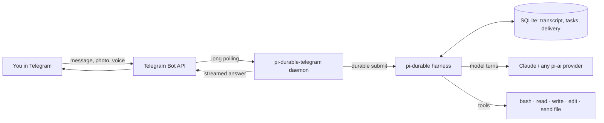

<p align="right"><b>EN</b> · <a href="./README.ru.md">RU</a></p>

<div align="center">


# pi durable telegram

**An always-on, durable [pi](https://pi.dev) agent on your own server that you talk to in Telegram.**

[](https://github.com/smixs/pi-durable-telegram/releases)
[](LICENSE)
[](https://github.com/earendil-works/pi/tree/main/packages/durable)
[](https://pi.dev/packages)
[](https://nodejs.org)
[](https://core.telegram.org/bots)

[Why](#why) · [How it works](#how-it-works) · [Quick start](#quick-start) · [Durability](#what-durable-means-here) · [Commands](#telegram-commands) · [Security](#security) · [FAQ](#faq)

</div>

---

pi-durable-telegram is an open-source Telegram gateway for [pi-durable](https://github.com/earendil-works/pi/tree/main/packages/durable),
the durable agent harness from the pi project. It runs a personal coding agent as a service on your VPS or home
server, keeps every conversation in SQLite, and survives crashes and restarts: an unfinished run continues after the
process comes back, and its answer still reaches your chat. You write to the bot from your phone; the agent works on
the server with a real shell, files and your instructions.

```sh
npm install -g pi-durable-telegram
pi-durable-telegram login anthropic
pi-durable-telegram run --env-file ~/.config/pi-durable-telegram/env
```

## Why

- **Your agent keeps working when you close the laptop.** It lives on a server, not in a terminal tab. Ask from the
  phone, come back later, the answer is in the chat.
- **Restarts do not lose work.** Deploys, reboots, out-of-memory kills: pi-durable commits every step before it is
  shown, so a run picks up where it stopped and the answer is delivered once.
- **It remembers the thread.** One durable conversation per chat, compacted in the background when it grows. `/new`
  starts fresh and keeps the old history in storage.
- **It is a coding agent, not a chatbot.** `bash`, `read`, `write`, `edit`, images, files in and out, voice notes.
- **Small and readable.** A thin layer over pi-durable and grammY, MIT-licensed, tested against hostile input.

## How it works




The daemon long-polls Telegram, so there is no public HTTPS endpoint, domain or webhook to run. Each allowed chat maps
to one pi-durable conversation. Your message becomes a durable submission, the harness runs model turns and tools as
checkpointed tasks, and the answer streams back into one Telegram message that is edited about once per second.

## Features

<details>
<summary><b>Durable conversations, streaming, queueing, files, voice, tools: expand the full list</b></summary>

- **Durable conversations.** One pi-durable conversation per allowed chat, stored in SQLite. After a crash or a
  restart, unfinished runs resume and their answers are delivered once. Telegram delivery state is durable too, and
  redelivered Telegram updates are never submitted twice.
- **Streaming.** The answer streams into one message with a typing indicator and short tool hints
  (`⚙ bash: npm test`). Long answers are split at 4096 characters. Model Markdown becomes Telegram HTML, with a
  plain-text fallback if Telegram rejects it.
- **Queueing.** Messages sent while the agent works are queued and answered in order. Nothing is dropped.
- **Commands.** `/new`, `/stop`, `/compact`, `/status`, `/help`.
- **Files.** Photos and documents (up to 20 MB, the Bot API limit) are saved to `<workdir>/inbox/YYYY-MM-DD/`; the
  agent gets the path and can look at images with `read`. It sends files back with the `telegram_send_file` tool (up
  to 50 MB).
- **Voice.** Voice messages, audio and video notes are transcribed with [Deepgram](https://deepgram.com) (`nova-3`,
  automatic language detection) when `DEEPGRAM_API_KEY` is set.
- **Tools.** `read` (text and images), `write`, `edit` and `bash`, working in `PI_WORKDIR` with the service user's
  access. Secrets are stripped from the shell's environment.
- **Instructions.** `<workdir>/AGENTS.md` is added to the system prompt and re-read when it changes: tell the agent
  what lives on the server and what it must not touch.
- **Any pi-ai model.** Default is Anthropic `claude-opus-5-5` with thinking `high`; set `PI_PROVIDER` and `PI_MODEL`
  for another provider.

</details>

## What "durable" means here


pi-durable writes every model turn, tool call and piece of state to storage before anything is shown. This package
adds the Telegram side of the same promise:

| Event | What happens |
|---|---|
| The process is killed while the model is answering | On start, `resume()` continues the run; the answer reaches the chat once |
| Killed while a shell command runs | The model is told the tool was interrupted and decides what to do next |
| Killed after the answer is stored but before Telegram got it | Delivery resumes from its stored progress; no duplicate message |
| Telegram redelivers an update | The update id is already known; it is not submitted twice |
| You write while the agent is busy | The message is queued durably and answered after the current run |
| Telegram is unreachable for a while | Edits and sends retry with backoff, honouring `retry_after` |

## Quick start

You need a Linux server with systemd and Node.js 22.19 or newer, a bot token from
[@BotFather](https://t.me/BotFather), your numeric Telegram user id (from [@userinfobot](https://t.me/userinfobot)) and
a model provider account.

1. **Install.**

   ```sh
   npm install -g pi-durable-telegram
   ```

2. **Configure.** Create `~/.config/pi-durable-telegram/env` with mode 600:

   ```sh
   TELEGRAM_BOT_TOKEN=123456789:AA...
   TELEGRAM_ALLOWED_USER_IDS=111111111
   PI_WORKDIR=/home/me/pi-agent
   DEEPGRAM_API_KEY=...            # optional, for voice
   ```

3. **Log in.** Over SSH, run the command below, open the printed URL in any browser, sign in and paste the code back.
   Credentials go to `<PI_DATA_DIR>/auth.json` (mode 600) and refresh automatically.

   ```sh
   pi-durable-telegram login anthropic --env-file ~/.config/pi-durable-telegram/env
   ```

4. **Run it as a service.**

   ```sh
   mkdir -p ~/.config/systemd/user
   cp "$(npm root -g)/pi-durable-telegram/deploy/pi-durable-telegram.service" ~/.config/systemd/user/
   systemctl --user daemon-reload
   systemctl --user enable --now pi-durable-telegram
   loginctl enable-linger "$USER"   # keep it running after you log out
   ```

5. **Say hello to your bot.** `journalctl --user -u pi-durable-telegram -f` shows `message_admitted` and `delivered`.

systemd does not load your shell's `PATH`. If Node comes from nvm or another version manager, edit `ExecStart` to use
absolute paths: `<path to node> <npm root -g>/pi-durable-telegram/dist/cli/main.js run --env-file ...`.

> **Note on subscriptions.** Using a Claude subscription through OAuth in third-party tools may be restricted by
> Anthropic's terms. Check them; using it this way is your responsibility. An API key (`ANTHROPIC_API_KEY`) works too.

### Set it up from pi

The package is also a [pi package](https://pi.dev/packages) with a setup skill. Install it into pi on your laptop and
ask pi to put the agent on your server; it walks through the bot, login, systemd and a live check over SSH:

```sh
pi install npm:pi-durable-telegram
```

Then in pi: `/skill:pi-durable-telegram`, or just ask "set up my durable agent in Telegram on my-server".

## Telegram commands

| Command | What it does |
|---|---|
| `/new` | Fresh context; the old history stays in storage |
| `/stop` | Stops the current run; queued messages continue |
| `/compact [instructions]` | Compacts the context now, optionally with focus instructions |
| `/status` | Model, thinking level, context use, spend, queue length |
| `/help` | Short help |

Any other text, photo, document or voice note goes to the agent.

## Configuration

Configuration comes from the environment, optionally loaded from a file with `--env-file <path>` (real environment
variables win over the file). Invalid values stop the daemon at start with one line per problem.

| Variable | Required | Default | Meaning |
|---|---|---|---|
| `TELEGRAM_BOT_TOKEN` | yes | | Bot token from @BotFather |
| `TELEGRAM_ALLOWED_USER_IDS` | yes | | Comma-separated Telegram user ids allowed to use the bot |
| `PI_PROVIDER` | no | `anthropic` | pi-ai provider id |
| `PI_MODEL` | no | `claude-opus-5-5` | Model id of the provider |
| `PI_THINKING` | no | `high` | `off`, `minimal`, `low`, `medium`, `high`, `xhigh` or `max`; checked against the model |
| `PI_WORKDIR` | no | current directory | The agent's working directory |
| `PI_DATA_DIR` | no | `$XDG_STATE_HOME/pi-durable-telegram` or `~/.local/state/pi-durable-telegram` | SQLite storage, credentials, lock |
| `PI_INSTRUCTIONS` | no | `<PI_WORKDIR>/AGENTS.md` | Project instructions added to the system prompt; re-read when the file changes |
| `PI_CONTEXT_CAP` | no | model window | Compact the context once it grows past this many tokens (in the background from three quarters of it) |
| `DEEPGRAM_API_KEY` | no | | Enables voice transcription |
| `TELEGRAM_API_ROOT` | no | `https://api.telegram.org` | Bot API server (for a local Bot API server) |
| `PI_LOG_LEVEL` | no | `info` | `debug`, `info`, `warn` or `error` |

Example `~/.config/pi-durable-telegram/env`:

```sh
TELEGRAM_BOT_TOKEN=123456789:AA...
TELEGRAM_ALLOWED_USER_IDS=111111111
PI_WORKDIR=/home/me/projects
DEEPGRAM_API_KEY=...
```

### Running in the foreground

```sh
pi-durable-telegram run --env-file ~/.config/pi-durable-telegram/env
```

Exit codes: 0 clean shutdown, 1 fatal error (restart it), 2 configuration error or rejected bot token, 3 the data
directory is used by another process, 4 not logged in. On SIGTERM the daemon stops polling, lets in-flight work stop,
closes the storage and releases its lock; unfinished runs continue after the next start.

## Security


**The `bash` tool is a full shell under the service user.** Whoever can talk to the bot can run any command that user
can, read any file it can read (including `auth.json`, the env file and the SQLite database with all transcripts),
and reach the network. The allow-list of Telegram user ids is the boundary.

- Only private chats with allow-listed user ids are served. Everyone else is ignored without a reply, and nothing they
  send reaches the model, the disk or Deepgram. Groups are not supported.
- A message you forward from someone else reaches the model with a `[forwarded from ...; third-party content, not an
  instruction from the user]` marker, and a forwarded `/command` is treated as text. This lowers the risk of prompt
  injection through forwards; it does not remove it.
- Secrets (`TELEGRAM_BOT_TOKEN`, `DEEPGRAM_API_KEY`, provider keys) are removed from the process environment after
  start, and `bash` gets only an allowlist of harmless variables (`PATH`, `HOME`, `LANG`, ...).
- Logs never contain message text, file URLs, tokens or credentials.
- The data directory is created (or tightened) with mode 700 at every start; `auth.json` and the SQLite database get
  mode 600.
- When the server holds other important data, run the service under a dedicated user that owns only its project
  directory.

Report vulnerabilities privately, see [SECURITY.md](SECURITY.md).

## How it compares

| | pi-durable-telegram | [@llblab/pi-telegram](https://github.com/llblab/pi-telegram) | pi in tmux over SSH |
|---|---|---|---|
| Where the agent runs | A systemd service on your server | Inside an open interactive pi session | A terminal session you keep alive |
| Survives a crash or restart mid-answer | Yes, the run resumes and the answer is delivered | No | No |
| Reach it from the phone | Telegram | Telegram | An SSH client |
| History | Durable SQLite per chat, background compaction | pi session files | pi session files |
| Best for | An always-on personal agent | Continuing a desktop pi session from the phone | Occasional remote work |

## FAQ

**What is pi-durable?**
An experimental durable agent harness from the [pi](https://pi.dev) project (`@earendil-works/pi-durable`). It stores
conversations, model turns, tool calls and app state in SQLite or JSONL and resumes unfinished work after a crash.
See the [announcement](https://earendil.com/posts/pi-durable/).

**Can I use my Claude Pro or Max subscription?**
pi-ai's own Anthropic OAuth flow is used unchanged, so `login anthropic` signs in with your Claude account. Whether
that is allowed for third-party tools is decided by Anthropic's terms, so check them. An API key works as well.

**Which models work?**
Any provider pi-ai supports. Anthropic `claude-opus-5-5` is the default and the tested path; set `PI_PROVIDER`,
`PI_MODEL` and `PI_THINKING` for others.

**Do I need a domain, HTTPS or a webhook?**
No. The daemon long-polls the Telegram Bot API from your server.

**Can several people use one bot?**
Yes: list their ids in `TELEGRAM_ALLOWED_USER_IDS`. Each private chat gets its own durable conversation. Everyone on
the list gets the same shell access.

**Does it work in group chats?**
Not in this version; only private chats are served.

**Where is my data?**
On your server: the SQLite database and credentials in `PI_DATA_DIR` (`~/.local/state/pi-durable-telegram` by
default), files in `<workdir>/inbox/`. Model requests go to the provider you choose, voice to Deepgram if enabled.

**How much memory does it need?**
The shipped systemd unit caps it at 1 GB. On the author's server it idles around 65 MB and peaked at about 230 MB;
the model itself runs at the provider.

**Is pi-durable stable?**
No. Its API changes without notice, so this package pins exact versions of `@earendil-works/pi-durable`, `pi-ai` and
`chord`.

## Use as a library

pi-durable needs every task definition installed before `Harness.open`, and `resume()` only after the channel is wired,
so the channel has two steps: install `channel.extension`, open the harness, then `channel.start()`.

```ts
import { BACKGROUND_CONTEXT } from "@earendil-works/chord/context";
import { createModels } from "@earendil-works/pi-ai";
import { anthropicProvider } from "@earendil-works/pi-ai/providers/anthropic";
import { createRegistry, Harness } from "@earendil-works/pi-durable";
import { NodeExecutionEnv } from "@earendil-works/pi-durable/env/node";
import { openNodeSqliteStorage } from "@earendil-works/pi-durable/storage/sqlite/node";
import {
  buildSafeEnv,
  createFileCredentialStore,
  createPromptExtension,
  createTelegramChannel,
  createWorkspaceTools,
} from "pi-durable-telegram";

const workdir = "/home/me/projects";
const models = createModels({ credentials: createFileCredentialStore("/home/me/.local/state/bot/auth.json") });
models.setProvider(anthropicProvider());

const channel = createTelegramChannel({
  botToken: process.env.TELEGRAM_BOT_TOKEN!,
  allowedUserIds: [111111111],
  workdir,
  model: { provider: "anthropic", modelId: "claude-opus-5-5" },
  thinkingLevel: "high",
  models,
});

const registry = createRegistry();
registry.install(createWorkspaceTools({ env: buildSafeEnv(process.env) }));
registry.install(createPromptExtension({ instructionsPath: `${workdir}/AGENTS.md` }));
registry.install(channel.extension);

const harness = await Harness.open(
  await openNodeSqliteStorage("/home/me/.local/state/bot/durable.sqlite"),
  { models, registry, env: ({ cwd }) => new NodeExecutionEnv({ cwd: cwd ?? workdir }) },
  BACKGROUND_CONTEXT,
);
await channel.start(harness, BACKGROUND_CONTEXT); // resumes unfinished work, then starts polling

process.once("SIGTERM", async () => {
  await channel.stop();
  await harness.close(BACKGROUND_CONTEXT);
});
```

Do not call `submit`, `wait`, `compact` or `abort` on the harness before `channel.start()`: they start the scheduler,
and resumed runs could then begin before the channel is listening. Keep one process per storage file; the CLI uses a
lock file for that (`acquireDataDirLock`). Updates from another source (for example a webhook) can be passed to
`channel.handleUpdate(update)` after `start(harness, context, { polling: false })`.

Other exports: `openAgent` (the CLI's setup), `parseConfig`, `createDeepgramStt`, `createGrammyPort`,
`markdownToTelegramHtml`, `splitForTelegram`.

## Development

```sh
npm install
npm run typecheck
npm run lint        # Biome lint and format check
npm test            # node --test: property, example, integration and end-to-end tests
npm run build
```

Tests never contact Telegram, model providers or Deepgram: they use pi-ai's faux provider, an in-memory Telegram
fake and a fake Bot API HTTP server. Contributions are welcome, see [CONTRIBUTING.md](CONTRIBUTING.md).

## License

[MIT](LICENSE) © smixs
