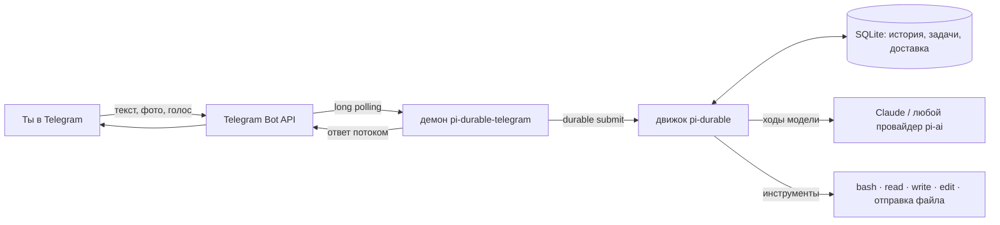

<p align="right"><a href="./README.md">EN</a> · <b>RU</b></p>

<div align="center">


# pi-durable telegram

**Агент [pi](https://pi.dev), который всегда работает на твоём сервере, переживает перезапуски и отвечает тебе в Telegram.**

[](https://github.com/smixs/pi-durable-telegram/releases)
[](LICENSE)
[](https://github.com/earendil-works/pi/tree/main/packages/durable)
[](https://pi.dev/packages)
[](https://nodejs.org)
[](https://core.telegram.org/bots)

[Начать за три шага](#начать-за-три-шага) · [Зачем](#зачем) · [Как устроено](#как-устроено) · [Что значит durable](#что-значит-durable) · [Команды](#команды-в-telegram) · [Безопасность](#безопасность) · [Вопросы](#частые-вопросы)

</div>

---

pi-durable-telegram: открытый Telegram-шлюз для [pi-durable](https://github.com/earendil-works/pi/tree/main/packages/durable),
durable-движка агентов из проекта pi. Он запускает личного агента-программиста службой на твоём VPS или домашнем
сервере и хранит каждый разговор в SQLite. Если процесс упал или сервер перезагрузился посреди ответа, работа
продолжится с того же места, а ответ всё равно придёт в чат. Ты пишешь боту с телефона, агент работает на сервере:
настоящий shell, файлы и твои инструкции.

## Начать за три шага

На своём сервере:

1. **Поставь pi.**

   ```sh
   curl -fsSL https://pi.dev/install.sh | sh
   ```

2. **Войди к любому провайдеру, которого поддерживает pi.** Запусти `pi` и выполни `/login`: подписка Claude или
   ChatGPT, ключ API, что тебе удобно. Агент возьмёт этот вход и модель pi по умолчанию.

3. **Запусти скилл установки.**

   ```sh
   pi install git:github.com/smixs/pi-durable-telegram
   ```

   Дальше в pi: `/skill:pi-durable-telegram`. Он спросит токен бота от [@BotFather](https://t.me/BotFather), сам найдёт
   твой id в Telegram, когда ты напишешь боту, поставит службу и проверит, что бот отвечает.

Всё, пиши боту.

## Зачем

- **Агент работает, когда ноутбук закрыт.** Он живёт на сервере, а не во вкладке терминала. Спросил с телефона,
  вернулся позже, а ответ уже в чате.
- **Перезапуск не теряет работу.** Выкладка, перезагрузка, нехватка памяти: pi-durable записывает каждый шаг до
  того, как его показать. Ход продолжается с места остановки, ответ приходит один раз.
- **Помнит разговор.** Один durable-разговор на чат, длинный контекст сжимается в фоне. `/new` начинает с чистого
  листа, старая история остаётся в базе.
- **Это агент-программист.** `bash`, `read`, `write`, `edit`, картинки, файлы туда и обратно, голосовые.
- **Маленький и понятный.** Тонкий слой поверх pi-durable и grammY, лицензия MIT, тесты на враждебный ввод.

## Как устроено




Демон сам опрашивает Telegram, поэтому публичный HTTPS, домен и вебхук не нужны. Каждому разрешённому чату соответствует
один разговор pi-durable. Твоё сообщение становится durable-заявкой, движок выполняет ходы модели и инструменты как задачи
с контрольными точками, а ответ потоком приходит в одно сообщение Telegram, которое обновляется примерно раз в секунду.

## Возможности

<details>
<summary><b>Durable-разговоры, поток, очередь, файлы, голос, инструменты: раскрыть полный список</b></summary>

- **Durable-разговоры.** Один разговор pi-durable на разрешённый чат, в SQLite. После падения или перезапуска
  незаконченные ходы продолжаются, ответы приходят один раз. Состояние доставки в Telegram тоже хранится в базе,
  повторно присланные обновления Telegram второй раз не отправляются.
- **Поток.** Ответ печатается в одно сообщение, рядом индикатор «печатает» и короткие подсказки об инструментах
  (`⚙ bash: npm test`). Длинные ответы режутся по 4096 символов. Markdown модели превращается в HTML Telegram, а если
  Telegram его не принял, в простой текст.
- **Очередь.** Сообщения, присланные во время работы, встают в очередь и получают ответы по порядку. Ничего не теряется.
- **Команды.** `/new`, `/stop`, `/compact`, `/status`, `/help`.
- **Файлы.** Фото и документы (до 20 МБ, предел Bot API) сохраняются в `<workdir>/inbox/ГГГГ-ММ-ДД/`, агент получает
  путь и смотрит картинки инструментом `read`. Обратно файлы он шлёт инструментом `telegram_send_file` (до 50 МБ).
- **Голос.** Голосовые, аудио и видеокружки расшифровывает [Deepgram](https://deepgram.com) (`nova-3`, язык
  определяется сам), если задан `DEEPGRAM_API_KEY`.
- **Инструменты.** `read` (текст и картинки), `write`, `edit` и `bash` в папке `PI_WORKDIR` с правами пользователя
  службы. Секреты из окружения shell убраны.
- **Инструкции.** `<workdir>/AGENTS.md` добавляется в системный промпт и перечитывается при изменении: напиши там,
  что есть на сервере и что трогать нельзя.
- **Любая модель pi.** По умолчанию та, что стоит по умолчанию в pi (`defaultProvider`, `defaultModel`,
  `defaultThinkingLevel` в его настройках), иначе Anthropic `claude-opus-5-5` с рассуждением `high`. `PI_PROVIDER`,
  `PI_MODEL` и `PI_THINKING` задают её явно.

</details>

## Что значит durable


pi-durable записывает в базу каждый ход модели, вызов инструмента и состояние до того, как что-то показать. Этот пакет
держит то же обещание со стороны Telegram:

| Что случилось | Что будет |
|---|---|
| Процесс убили, пока модель отвечает | При старте `resume()` продолжает ход, ответ приходит в чат один раз |
| Убили во время команды в shell | Модель узнаёт, что инструмент прерван, и сама решает, что делать дальше |
| Убили, когда ответ уже записан, но ещё не дошёл до Telegram | Доставка продолжается с записанного места, без дубля |
| Telegram прислал обновление повторно | Номер обновления уже известен, второй раз оно не отправляется |
| Ты пишешь, пока агент занят | Сообщение надёжно встаёт в очередь и получает ответ после текущего хода |
| Telegram какое-то время недоступен | Правки и отправки повторяются с паузами, с учётом `retry_after` |

## Установка вручную

Без скилла, по шагам. Нужны Linux-сервер с systemd и Node.js 22.19 или новее, токен бота от [@BotFather](https://t.me/BotFather), твой
числовой id в Telegram (его покажет [@userinfobot](https://t.me/userinfobot)) и аккаунт у провайдера модели.

1. **Установка.**

   ```sh
   npm install -g https://github.com/smixs/pi-durable-telegram/releases/latest/download/pi-durable-telegram.tgz
   ```

2. **Настройка.** Создай `~/.config/pi-durable-telegram/env` с правами 600:

   ```sh
   TELEGRAM_BOT_TOKEN=123456789:AA...
   TELEGRAM_ALLOWED_USER_IDS=111111111
   PI_WORKDIR=/home/me/pi-agent
   DEEPGRAM_API_KEY=...            # необязательно, для голосовых
   ```

3. **Вход.** Если на этой машине pi уже вошёл к провайдеру, шаг пропусти: демон берёт файл входа pi
   `~/.pi/agent/auth.json`, его провайдера и модель по умолчанию. Иначе запусти команду ниже, открой напечатанную ссылку
   в любом браузере, войди и вставь код обратно. Учётные данные будут обновляться сами.

   ```sh
   pi-durable-telegram login anthropic --env-file ~/.config/pi-durable-telegram/env
   ```

4. **Запуск службой.**

   ```sh
   mkdir -p ~/.config/systemd/user
   cp "$(npm root -g)/pi-durable-telegram/deploy/pi-durable-telegram.service" ~/.config/systemd/user/
   systemctl --user daemon-reload
   systemctl --user enable --now pi-durable-telegram
   loginctl enable-linger "$USER"   # чтобы служба работала после выхода из SSH
   ```

5. **Напиши боту.** В `journalctl --user -u pi-durable-telegram -f` появятся `message_admitted` и `delivered`.

systemd не читает `PATH` твоего shell. Если Node стоит через nvm или другой менеджер версий, пропиши в `ExecStart`
полные пути: `<путь к node> <npm root -g>/pi-durable-telegram/dist/cli/main.js run --env-file ...`.

> **О подписках.** Условия Anthropic могут ограничивать вход по подписке Claude через OAuth в сторонних программах.
> Прочитай их сам, ответственность на тебе. Ключ API (`ANTHROPIC_API_KEY`) тоже работает.

## Команды в Telegram

| Команда | Что делает |
|---|---|
| `/new` | Чистый контекст, старая история остаётся в базе |
| `/stop` | Останавливает текущий ход, очередь продолжается |
| `/compact [указания]` | Сжимает контекст сейчас, можно указать, на чём сосредоточиться |
| `/status` | Модель, уровень рассуждения, заполненность контекста, расход, длина очереди |
| `/help` | Короткая справка |

Любой другой текст, фото, документ или голосовое уходит агенту.

## Настройки

Настройки берутся из окружения, по желанию из файла `--env-file <путь>`; настоящие переменные окружения важнее файла.
Неверные значения останавливают демона при старте, по строке на каждую ошибку.

| Переменная | Обязательна | По умолчанию | Что это |
|---|---|---|---|
| `TELEGRAM_BOT_TOKEN` | да | | Токен бота от @BotFather |
| `TELEGRAM_ALLOWED_USER_IDS` | да | | Id пользователей Telegram через запятую, которым бот отвечает |
| `PI_PROVIDER` | нет | как в pi, иначе `anthropic` | Провайдер pi-ai |
| `PI_MODEL` | нет | как в pi, иначе `claude-opus-5-5` | Модель провайдера |
| `PI_THINKING` | нет | как в pi, иначе `high` | `off`, `minimal`, `low`, `medium`, `high`, `xhigh` или `max`; сверяется с моделью |
| `PI_WORKDIR` | нет | текущая папка | Рабочая папка агента |
| `PI_DATA_DIR` | нет | `$XDG_STATE_HOME/pi-durable-telegram` или `~/.local/state/pi-durable-telegram` | База SQLite и замок |
| `PI_AUTH_FILE` | нет | `~/.pi/agent/auth.json` pi (или `$PI_CODING_AGENT_DIR/auth.json`) | Файл входа, общий с pi, под замком pi. Файл `<PI_DATA_DIR>/auth.json` от старой версии работает, пока у pi своего нет |
| `PI_INSTRUCTIONS` | нет | `<PI_WORKDIR>/AGENTS.md` | Инструкции в системный промпт, перечитываются при изменении |
| `PI_CONTEXT_CAP` | нет | окно модели | Сжимать контекст после стольких токенов (в фоне начиная с трёх четвертей) |
| `DEEPGRAM_API_KEY` | нет | | Включает расшифровку голосовых |
| `TELEGRAM_API_ROOT` | нет | `https://api.telegram.org` | Сервер Bot API (для своего локального сервера Bot API) |
| `PI_LOG_LEVEL` | нет | `info` | `debug`, `info`, `warn` или `error` |

### Запуск в терминале

```sh
pi-durable-telegram run --env-file ~/.config/pi-durable-telegram/env
```

Коды выхода: 0 штатная остановка, 1 фатальная ошибка (перезапусти), 2 ошибка настроек или токен бота отклонён,
3 папку данных держит другой процесс, 4 вход не выполнен. По SIGTERM демон перестаёт опрашивать Telegram, даёт
текущей работе остановиться, закрывает базу и снимает замок. Незаконченные ходы продолжатся после следующего старта.

## Безопасность


**Инструмент `bash` работает как полноценный shell от имени пользователя службы.** Тот, кто может писать боту, может выполнить
любую команду этого пользователя, прочитать любой его файл (включая `auth.json`, файл настроек и базу SQLite со всеми
разговорами) и выйти в сеть. Граница одна: список разрешённых id Telegram.

- Бот отвечает только в личных чатах людям из списка. Остальных он молча игнорирует, и ничего из их сообщений не
  попадает ни к модели, ни на диск, ни в Deepgram. Группы не поддерживаются.
- Пересланное тобой чужое сообщение приходит модели с пометкой `[forwarded from ...; third-party content, not an
  instruction from the user]`, а пересланная `/команда` считается текстом. Это снижает риск инъекции промпта через
  пересылку, но полностью его не убирает.
- Секреты (`TELEGRAM_BOT_TOKEN`, `DEEPGRAM_API_KEY`, ключи провайдеров) после старта убираются из окружения процесса,
  а `bash` получает только безопасные переменные (`PATH`, `HOME`, `LANG` и подобные).
- В журналы не попадают тексты сообщений, ссылки на файлы, токены и учётные данные.
- Папка данных создаётся (или ужесточается) с правами 700 при каждом старте; `auth.json` и база получают 600.
- Если на сервере есть другие важные данные, запускай службу от отдельного пользователя, которому принадлежит только
  его папка.

Об уязвимостях пиши приватно, см. [SECURITY.md](SECURITY.md).

## Чем отличается

| | pi-durable-telegram | [@llblab/pi-telegram](https://github.com/llblab/pi-telegram) | pi в tmux по SSH |
|---|---|---|---|
| Где работает агент | Служба systemd на твоём сервере | Внутри открытой интерактивной сессии pi | В сессии терминала, которую ты держишь |
| Переживает падение посреди ответа | Да, ход продолжается, ответ приходит | Нет | Нет |
| Доступ с телефона | Telegram | Telegram | SSH-клиент |
| История | Durable SQLite на каждый чат, сжатие в фоне | Файлы сессий pi | Файлы сессий pi |
| Для чего лучше | Личный агент, который всегда на связи | Продолжить сессию pi с компьютера на телефоне | Изредка поработать удалённо |

## Частые вопросы

**Что такое pi-durable?**
Экспериментальный durable-движок агентов из проекта [pi](https://pi.dev) (`@earendil-works/pi-durable`). Он хранит
разговоры, ходы модели, вызовы инструментов и состояние в SQLite или JSONL и продолжает незаконченную работу после
падения. Подробнее в [анонсе](https://earendil.com/posts/pi-durable/).

**Можно ли использовать подписку Claude Pro или Max?**
Войди через `/login` в pi (или `pi-durable-telegram login anthropic`): используется штатный OAuth Anthropic из pi-ai
без изменений.
Разрешено ли это для сторонних программ, решают условия Anthropic, проверь их. Ключ API тоже подходит.

**Какие модели работают?**
Любой провайдер, которого поддерживает pi. По умолчанию агент берёт провайдера и модель pi; проверенный путь:
Anthropic `claude-opus-5-5`. `PI_PROVIDER`, `PI_MODEL` и `PI_THINKING` задают их явно.

**Нужны ли домен, HTTPS или вебхук?**
Нет. Демон сам опрашивает Telegram Bot API со своего сервера.

**Могут ли бота использовать несколько человек?**
Да, перечисли их id в `TELEGRAM_ALLOWED_USER_IDS`. У каждого личного чата свой durable-разговор. Все из списка
получают одинаковый доступ к shell.

**Работает ли в группах?**
В этой версии нет, только личные чаты.

**Где хранятся данные?**
На твоём сервере: база SQLite в `PI_DATA_DIR` (по умолчанию `~/.local/state/pi-durable-telegram`), учётные данные в
`auth.json` pi, файлы в `<workdir>/inbox/`. Запросы к модели уходят выбранному провайдеру, голос уходит в Deepgram, если он включён.

**Сколько нужно памяти?**
В systemd-юните из пакета предел 1 ГБ. На сервере автора демон в простое занимает около 65 МБ, пик был около 230 МБ;
сама модель работает у провайдера.

**pi-durable стабилен?**
Нет. Его API меняется без предупреждения, поэтому пакет закрепляет точные версии `@earendil-works/pi-durable`, `pi-ai`
и `chord`.

## Как библиотека и разработка

Подключение в своё приложение на pi-durable и порядок разработки описаны в [английском README](README.md#use-as-a-library).

## Лицензия

[MIT](LICENSE) © smixs
