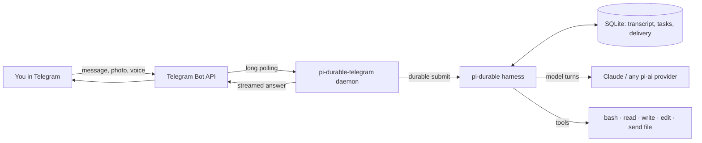

# How it works

The daemon long-polls Telegram, so there is no public HTTPS endpoint, domain or webhook to run. Each allowed chat maps
to one pi-durable conversation. Your message becomes a durable submission, the harness runs model turns and tools as
checkpointed tasks, and the answer streams back as a native Telegram draft (or, where drafts are refused, one message
edited about once per second) and is then sent as a rich message.

## Features in detail

- **Durable conversations.** One pi-durable conversation per allowed chat, stored in SQLite. After a crash or a
  restart, unfinished runs resume and their answers are delivered once. Telegram delivery state is durable too, and
  redelivered Telegram updates are never submitted twice.
- **Streaming.** A run shows a "Thinking…" draft (`sendRichMessageDraft`), then streams the answer and short tool
  hints (`⚙ bash: npm test`) into it, refreshing it during long tool calls. Its stop button does what `/stop` does.
  If Telegram refuses the draft, the answer streams into one edited message instead.
- **Rich answers.** The final answer is sent with `sendRichMessage`: Telegram renders the model's Markdown with
  headings, tables, task lists and `
` folds. Long answers are split at blank lines within 30,000 characters
  and about 400 blocks per message. If Telegram refuses a rich message, that part and the rest go out as Telegram
  HTML (split at 4096 characters, plain text if the HTML is refused too). `TELEGRAM_RICH=never` keeps HTML only.
- **Buttons.** The model ends a question with `<tg-button type="callback_data" data="…">` buttons. Data longer than
  64 bytes is cut on a character boundary (with `#2`, `#3` when two cuts collide). A tap from an allowed user is
  answered at once and becomes the user's next message: the button's data plus a line naming the message it was
  under. It is admitted once per tap, so a redelivered tap is not submitted twice. The pressed button is then marked
  ✅ and the message's other choices are disabled. There is no waiting state: typing instead of tapping is just a
  message, and buttons keep working after a restart (old ones may just stay unmarked).
- **Queueing.** Messages sent while the agent works are queued and answered in order. Nothing is dropped.
- **Commands.** `/new`, `/stop`, `/compact`, `/status`, `/help`.
- **Anything you send reaches the agent.** Photos, documents, videos, animations and stickers (up to 20 MB, the Bot
  API limit) are saved to `<workdir>/inbox/YYYY-MM-DD/`; the agent gets the path and decides what to do with the
  file (it can look at images with `read`). A file that is too big or fails to download is still reported to the
  agent with its name, size and the reason. A location, contact, poll or any other message without text or a file
  arrives as its own fields. The agent sends files back with the `telegram_send_file` tool (up to 50 MB).
- **Voice.** Voice messages, audio and video notes are transcribed with [Deepgram](https://deepgram.com) (`nova-3`,
  automatic language detection) when `DEEPGRAM_API_KEY` is set. Without a key, or when transcription fails, the audio
  is saved like any other file and the agent is told why there is no transcript.
- **Tools.** `read` (text and images), `write`, `edit` and `bash`, working in `PI_WORKDIR` with the service user's
  access. Secrets are stripped from the shell's environment.
- **Instructions.** `<workdir>/AGENTS.md` is added to the system prompt and re-read when it changes: tell the agent
  what lives on the server and what it must not touch.
- **Any pi-ai model.** The model pi uses by default (`defaultProvider`, `defaultModel`, `defaultThinkingLevel` in
  pi's settings), else Anthropic `claude-opus-5-5` with thinking `high`; `PI_PROVIDER`, `PI_MODEL` and `PI_THINKING`
  override it.

## What "durable" means here

pi-durable writes every model turn, tool call and piece of state to storage before anything is shown. This package
adds the Telegram side of the same promise:

| Event | What happens |
|---|---|
| The process is killed while the model is answering | On start, `resume()` continues the run; the answer reaches the chat once |
| Killed while a shell command runs | The model is told the tool was interrupted and decides what to do next |
| Killed after the answer is stored but before Telegram got it | Delivery resumes from its stored progress; a first message cut off mid-send is sent again (rarely twice), later parts never twice |
| Telegram redelivers an update | The update id is already known; it is not submitted twice |
| Killed while the answer streams as a draft | The draft disappears; the run resumes and the final answer is sent once |
| You write while the agent is busy | The message is queued durably and answered after the current run |
| Telegram is unreachable for a while | Edits and sends retry with backoff, honouring `retry_after` |

## How it compares

| | pi-durable-telegram | [@llblab/pi-telegram](https://github.com/llblab/pi-telegram) | pi in tmux over SSH |
|---|---|---|---|
| Where the agent runs | A systemd service on your server | Inside an open interactive pi session | A terminal session you keep alive |
| Survives a crash or restart mid-answer | Yes, the run resumes and the answer is delivered | No | No |
| Reach it from the phone | Telegram | Telegram | An SSH client |
| History | Durable SQLite per chat, background compaction | pi session files | pi session files |
| Best for | An always-on personal agent | Continuing a desktop pi session from the phone | Occasional remote work |

---

Back to the [README](../README.md).
